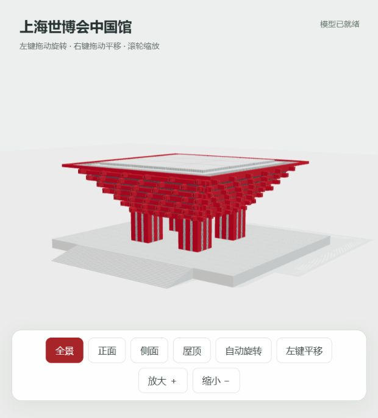

# 中国馆 3D 展示

基于 Three.js 的上海世博会中国馆交互展示模型。模型在 Blender 中制作、调整并导出为 GLB。

模型按照片做了展示化简化，重点表现红色外扩梁架、交错梁头、深灰格栅和九块屋顶体块；不是实测或施工模型。

## 本地运行

安装 Python 3 后，在项目目录运行：

```sh
python -m http.server 8767 --bind 127.0.0.1
```

浏览器打开 http://127.0.0.1:8767/ 。Windows 也可以双击 `打开预览.cmd`。

请通过本地服务器访问，不要直接双击 index.html。依赖已放在 vendor 目录，运行时无需加载外部 CDN。

## 操作

- 左键拖动：旋转；右键拖动：平移；滚轮：缩放。
- 点击“左键平移”可切换为左键平移模式。
- 提供全景、正面、侧面、屋顶、自动旋转及放大缩小按钮。

## 文件

- `index.html`：交互预览页面。
- `pavilion.glb`：当前精修版模型。
- `vendor/`：Three.js 0.170.0 和加载、控制模块。
- `presentation-web-preview.png`：网页截图。

Three.js 的 MIT 许可见 `vendor/THREE-LICENSE.txt`。仓库未为自有模型和页面另行授予开源许可。


